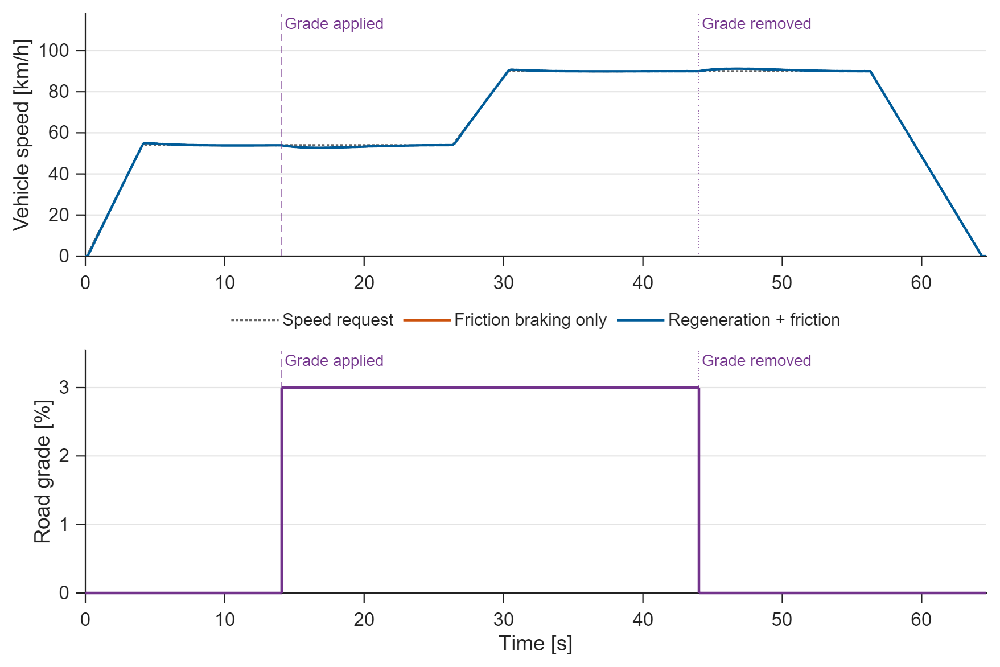
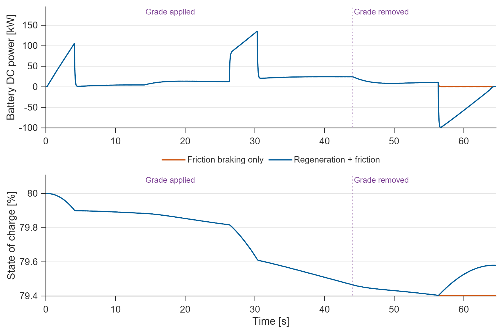
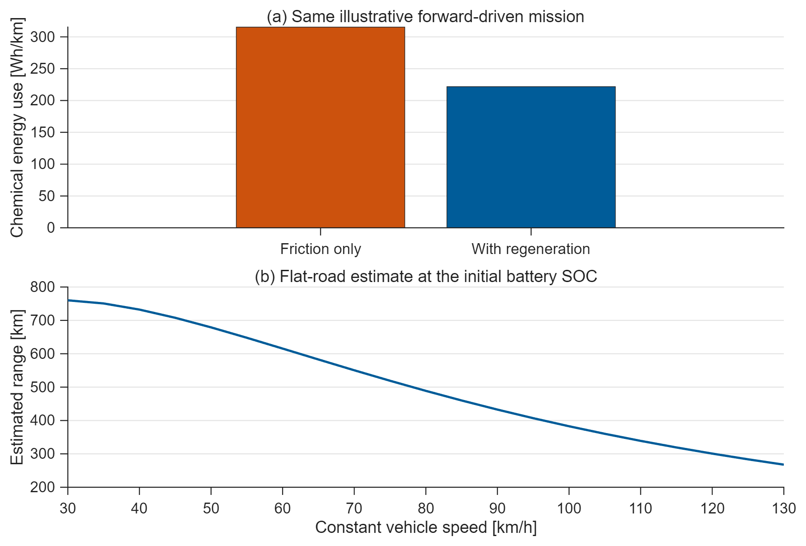
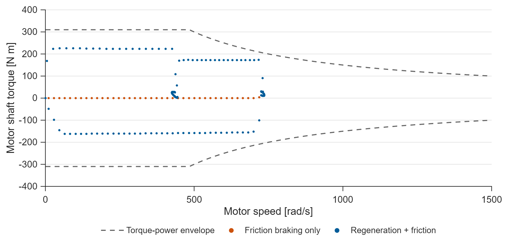

# Electric Vehicle Powertrain and Range

A forward-facing EV model with a driver PI, torque/power limits, direction-aware
drive losses, regenerative/friction brake blending, and a resistive battery.
Two braking strategies follow the same speed and road-grade mission.

## Run

Requires **MATLAB and Simulink**; verified on **R2025b**.
Open this folder and run `run_demo` or `run_demo(false)`.
Edit `project_parameters.m`. The editable model is `ev_powertrain.slx`.

## Results

**Figure 1. Forward mission.** The driver follows 15 and 25 m/s sections and
then brakes to rest. The independent 3% grade starts at 14.08 s and
ends at 44.00 s. Each later speed/grade change waits for the slower
braking case to settle. The endpoint is 64.64 s.

**Figure 2. Energy recovery.** Negative DC power means energy returns to the
battery. Regeneration recovers 114.58 Wh at the DC link and reduces
chemical-energy consumption by 29.66% on this illustrative mission.

**Figure 3. Consumption estimates.** Over 1.193 km, consumption is
315.3 Wh/km without regeneration and 221.8 Wh/km with regeneration.
Range assumes 54 kWh usable energy. The lower panel is a separate flat-road,
constant-speed calculation at the initial battery SOC, not a regulatory cycle.

**Figure 4. Feasible motor demand.** The motor has a 310 N m torque limit,
150 kW power limit and 1500 rad/s speed limit. Operating points include both
motoring and regeneration.

## Model and verification

`driver_controller.m` applies flat-road feedforward, PI feedback, motor limits,
and brake blending. Road grade enters only the plant. `power_flow.m` handles
power direction and solves the battery's quadratic power/current balance.
`vehicle_rhs.m` integrates speed, motor lag, SOC, distance and energy counters.

Settling checks speed, motor torque and driver force at every mission phase.
SOC, distance and cumulative energy are mission quantities, not stationary
settling targets. Final standstill uses a 0.02 m/s floor; the other phase bounds
are 2% of their excursions. A 10% final-recovery tail is retained. The measured
boundaries are in `results/timing.json`.

`run_demo` checks the Simulink trace against piecewise ODE solutions for both
braking strategies, motor/SOC bounds, battery power balance, and exact
SOC-to-chemical-energy accounting. The efficiency surface is illustrative,
not measured vehicle calibration. Tire slip, cell thermal behavior and detailed
inverter switching are outside this system-level model. Controllers use normal
simulation mode.

PNG figures, vector PDFs, CSV traces, parameters and measured metrics are in
`results/`. [MIT License](LICENSE).
